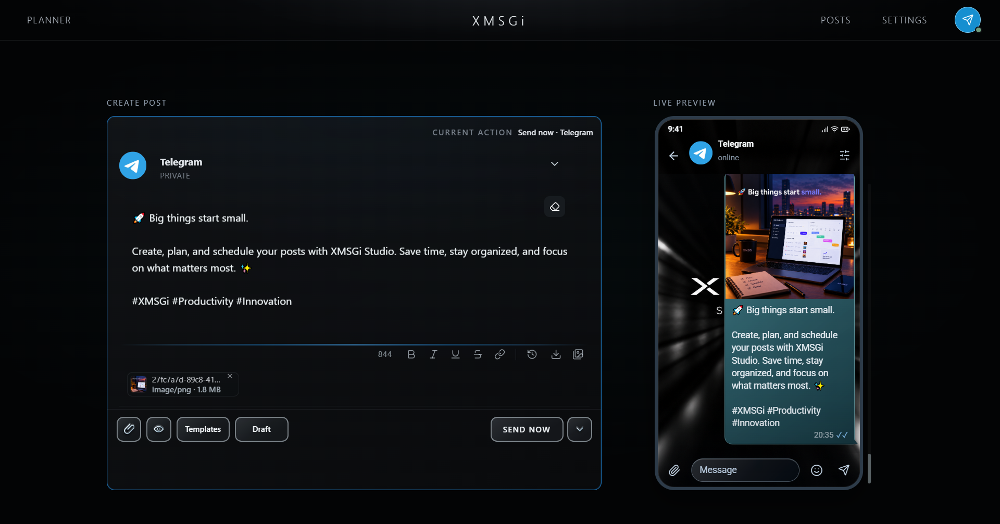
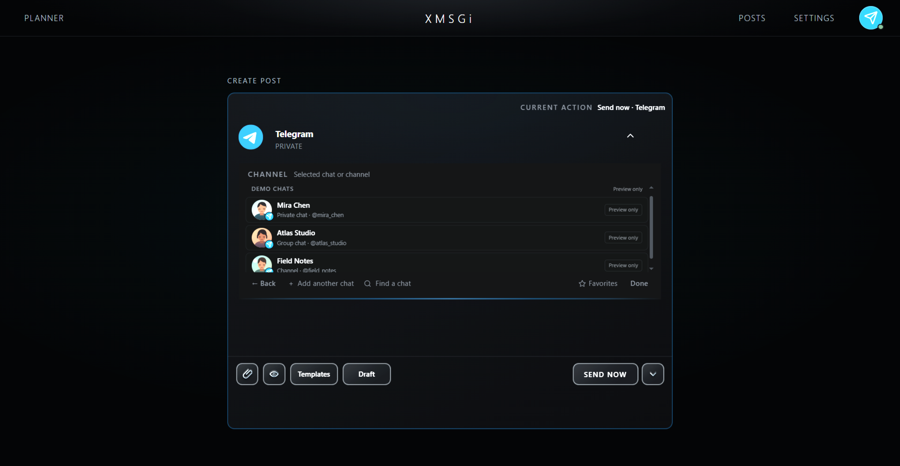
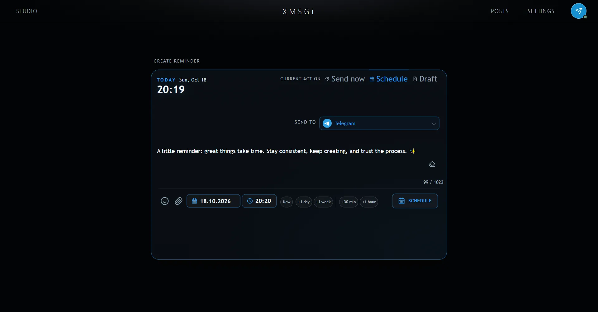
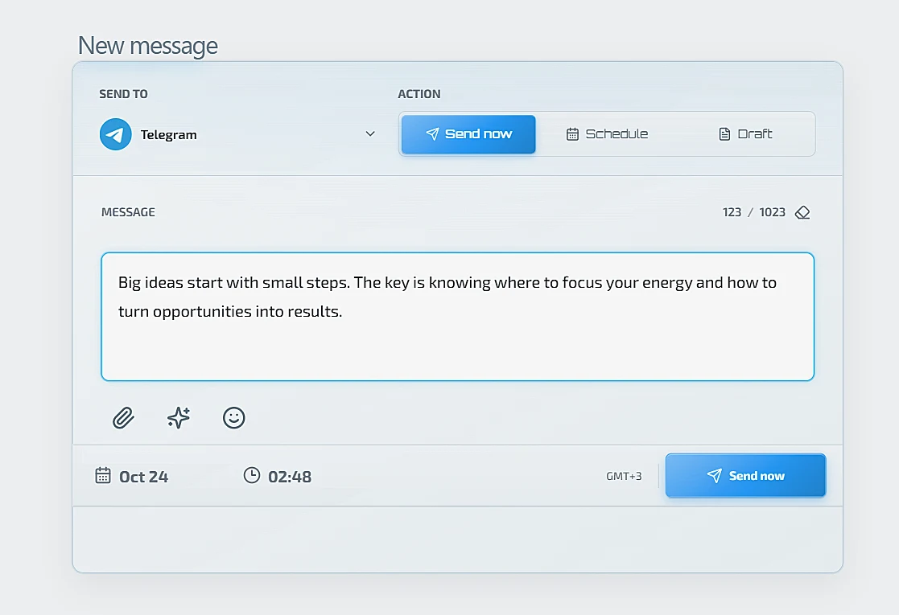

# Screenshots

Product screenshots of the **XMSGi Studio** desktop application, used by the website gallery.

| File | What it shows |
| --- | --- |
| `01.png` / `01.webp` | Main Studio editor and message preview. |
| `02.png` | Selecting Telegram chats and channels. |
| `03.png` / `03.webp` | Quick Planner composer and activity chart. |
| `04.png` / `04.webp` | Sign-in screen captured from the application. |

The hero uses 01, followed by 02, 03, and 04 in the gallery. WebP variants
are available for 01, 03, and 04; 02 is PNG only.

---

### Preview

